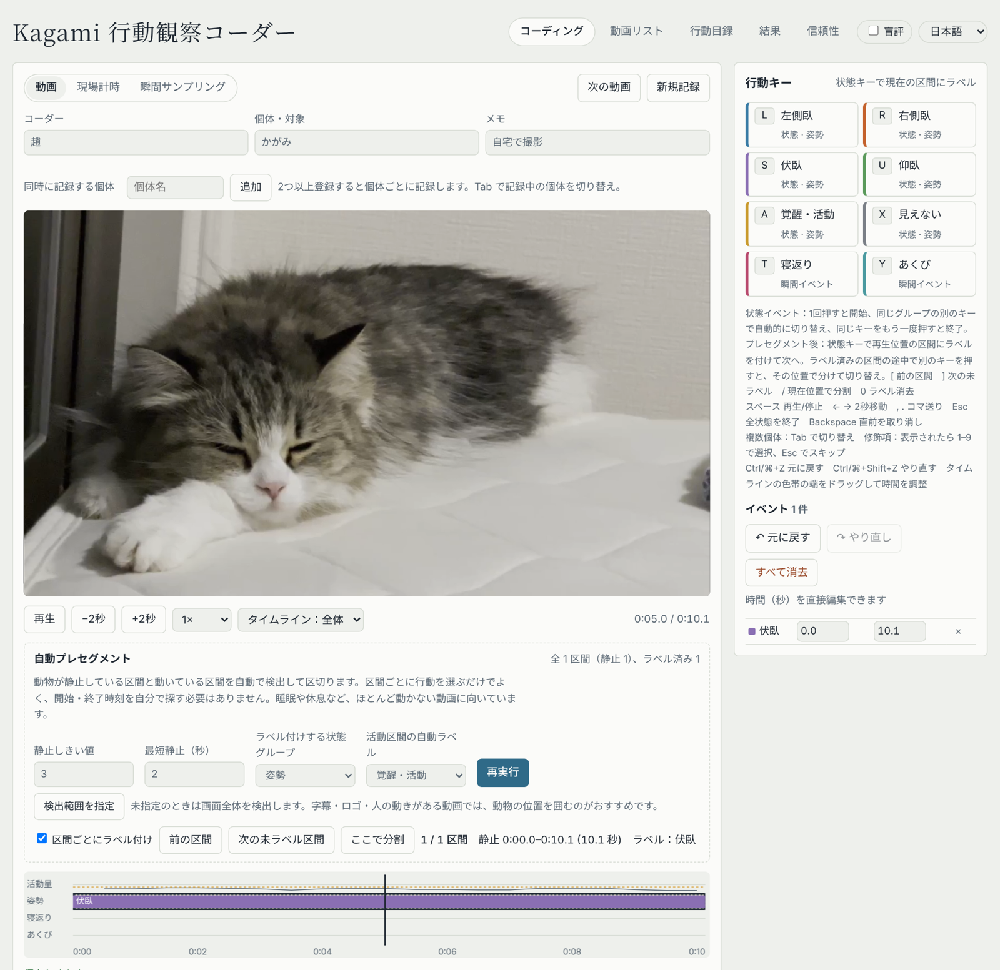

# Kagami 行動観察コーダー

動画から動物の行動を記録・分析するための、ブラウザで動く行動コーディングツールです。
インストールやアカウント登録は不要で、HTMLファイルを開くだけで使えます。

## 開発の背景

卒業研究で、猫が寝るときの体の向き（左右）を調べるために、インターネット上の動画を数百本記録する必要がありました。
既存の行動分析ソフトは機能が多く操作も複雑で、一本ずつ最後まで確認する方法では膨大な時間がかかっていました。

当初は AI に寝姿勢を自動判定させる方法を考えましたが、研究に使うには AI の判定精度を別途検証する必要があるため、方針を変えました。
「判断は人が行い、時間のかかる確認作業だけを機械に任せる」という考え方で、動画が静止しているかを自動で検出し、変化がある場面へすぐ移動できる仕組みを作りました。
これにより、30秒の静止動画を約2秒で記録できるようになりました。

## 主な機能

### 記録
- **3つの記録方法**：動画を見ながら記録／現場での計時記録／瞬間サンプリング（一定間隔で音が鳴り、そのときの行動を記録）
- **キーボードで記録**：行動ごとにキーを割り当て、押すだけで開始・終了を記録
- **自動プレセグメント**：動物が静止している区間と動いている区間を自動で検出して区切り、区間ごとに行動を選ぶだけで記録できます。検出範囲（ROI）の指定と、手持ち撮影の揺れを打ち消す手ブレ補正にも対応
- **複数個体の同時記録**、修飾項（モディファイア）の付与
- タイムライン上でのドラッグ編集、元に戻す／やり直し

### 管理
- **行動目録（エソグラム）**：行動の名前・キー・種類（状態／瞬間イベント）・グループを自由に設定
- **動画リスト**：記録の進み具合、除外理由、URL をまとめて管理。論文の方法セクション用の文章例も自動で作成
- **盲評モード**：条件などの情報を隠して記録できます

### 分析
- **側性化指数**の算出と、1標本 t 検定・符号検定
- **条件（独立変数）ごとの比較**
- **観察者間信頼性**：一致率と Cohen's κ の自動計算、信頼性サンプルの無作為抽出
- 行動ごとの回数・総時間・潜時などの集計、状態の切り替え回数
- CSV 出力、図（PNG）の書き出し、データのバックアップ・復元

### その他
- 日本語・中国語・英語・韓国語に対応

## 使い方

1. `index.html` をダウンロードし、ブラウザ（Chrome または Safari）で開きます。
   GitHub Pages で公開している場合は、そのページを開くだけで使えます。
2. 「行動目録」で記録したい行動とキーを設定します。
3. 「コーディング」で動画を選び、キーを押して記録します。
   ほとんど動かない動画では、「自動プレセグメント」を使うと区間ごとに素早く記録できます。
   スマートフォンを手で持って撮影した動画でも、「手ブレ補正」（初期設定でオン）が画面全体の揺れを打ち消すため、動物自身の動きだけを検出できます。
4. 「結果」で集計や側性化の分析を確認し、CSV や図を書き出します。

## データの保存について

- 動画はブラウザ内でのみ読み込まれ、どこにもアップロードされません。
- 記録はブラウザ内（localStorage）に保存されます。別のパソコンでは見られず、ブラウザのデータを消去すると失われるため、「結果」ページから定期的にバックアップしてください。

## 技術

- HTML / CSS / JavaScript（外部ライブラリなし、1ファイルで完結）
- 静止検出：一定間隔で動画のフレームを取り出し、縮小したグレースケール画像の隣接フレーム間の差分から動きの量を計算しています
- 手ブレ補正：差分を取る前に、画面全体の平行移動量を推定して前後のフレームを位置合わせします（低解像度での粗い探索→元の解像度での細かい探索→サブピクセル補間）。位置合わせでは差分の大きい画素の影響を抑えているため、動物自身の動きは打ち消されずに残ります

| テスト動画 | 補正なし | 補正あり |
|---|---|---|
| 手持ちで撮影した猫の動画（ほぼ静止） | 揺れを動きと誤検出し、3区間に分割 | 全体を静止と正しく判定 |
| 強い揺れ＋4〜7秒だけ物体が動く合成動画 | 全体を「活動」と誤判定 | 静止→活動→静止を正しく検出 |

## 開発について

プログラミング経験がほとんどない状態から、AI（Claude）を活用して開発しました。
研究に必要な機能の整理、実際の動画を使った動作確認、不具合の発見と修正の指示を自分で行い、改善を重ねています。

## 作者

趙梁（[@Ryo-Chao](https://github.com/Ryo-Chao)）
関西学院大学 文学部 総合心理科学科
